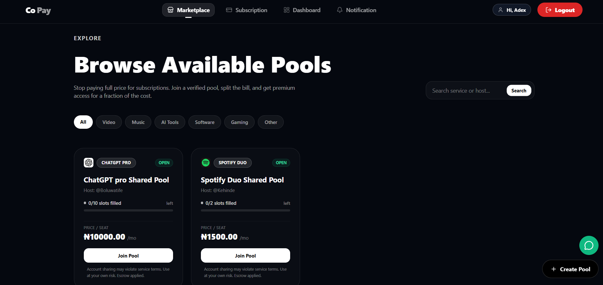
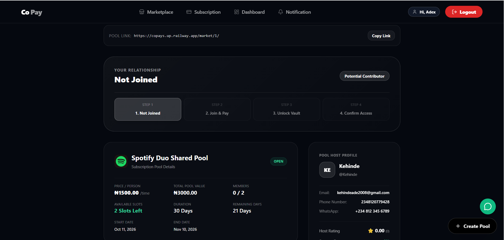
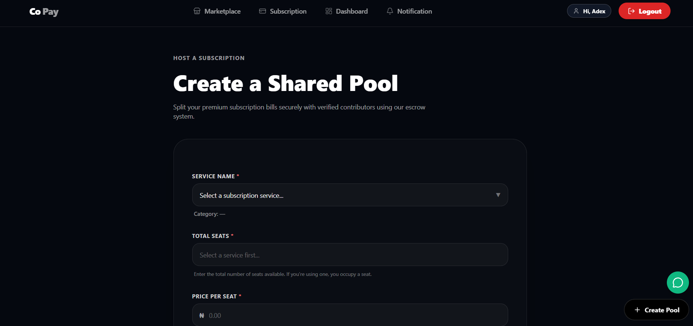
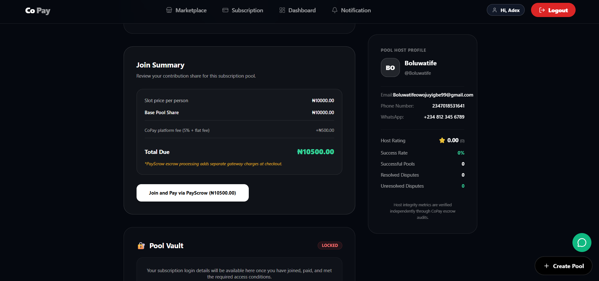
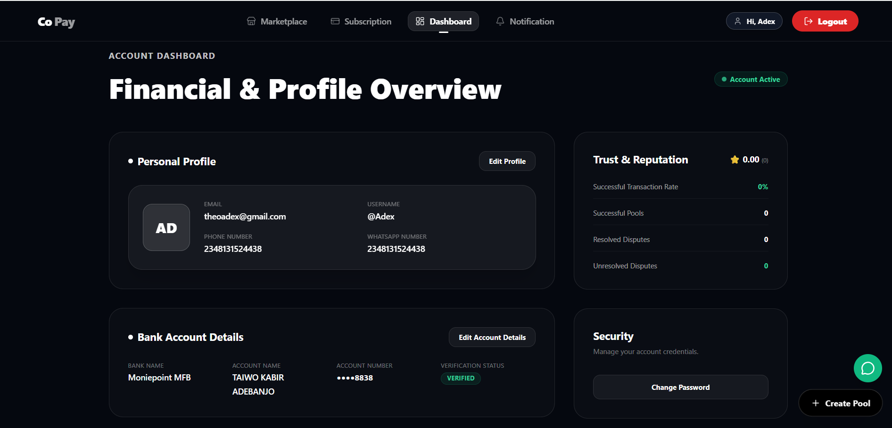
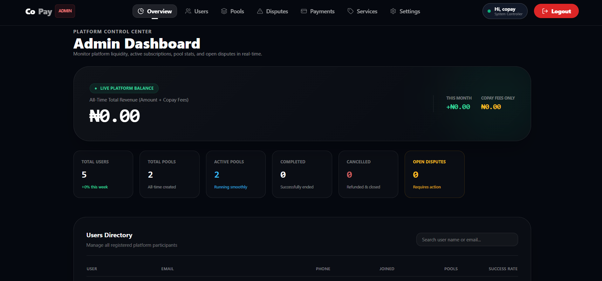

# CoPay

### Making Premium Subscriptions More Accessible Through Shared Payments

  <strong>A Django-powered platform for subscription sharing and pooled payments.</strong>
    
  
  

---

## 🌐 Live Application

**Explore CoPay:** https://copays.up.railway.app/

CoPay is a fintech platform designed to make premium digital subscriptions more accessible by helping users organize shared subscription costs through participation pools.

The platform brings pool discovery, membership management, and payment tracking together in one place.

## 💡 The Problem

Premium digital subscriptions, including streaming services, productivity software, and AI tools, can be expensive for individuals, especially students and people on limited budgets.

While some subscriptions support multiple users, coordinating contributions, finding participants, and managing payments can be difficult.

## 🚀 Our Solution

CoPay provides a structured platform where users can create or join subscription-sharing pools, manage participation, and follow the associated payment process.

The goal is to make subscription sharing more organized, transparent, and accessible.

## ✨ Features

- **Subscription Marketplace:** Discover available subscription-sharing pools.
- **Pool Creation:** Configure subscription pools and participation limits.
- **Pool Membership:** Join eligible pools and manage participation.
- **Public and Private Pools:** Support different pool visibility settings.
- **Payment Integration:** Integrate payment workflows through PayScrow.
- **Transaction Tracking:** Maintain records of payment status and transaction information.
- **User Management:** Support user accounts and profile management.
- **Pool Administration:** Provide tools for managing pools and overseeing platform activity.

*Feature availability depends on the current implementation and configuration.*

## 📸 Screenshots

### 1. Marketplace

Explore available subscription-sharing pools.

### 2. Pool Details and Joining

View a pool's information and explore its joining process.

### 3. Create a Pool

Create a subscription-sharing pool and configure its terms.

### 4. Payment Process

View the payment interface used in the pool participation workflow.

### 5. User Dashboard

Access relevant pool, membership, and account information.

### 6. Administration

Manage pools and oversee platform activity.

> Screenshots will appear here once the corresponding image files have been added to the repository.

## 🛠️ Technology Stack

| Technology | Purpose |
|---|---|
| Python | Backend programming |
| Django | Web application framework |
| Django ORM | Database operations |
| PostgreSQL | Relational database |
| HTML and CSS | User interface |
| PayScrow API | Payment and escrow workflow integration |
| Railway | Application deployment |
| Git and GitHub | Version control |

## ⚙️ How It Works

1. **Discover:** Browse available subscription-sharing pools.
2. **Select:** Review a pool's details, pricing, and participation terms.
3. **Join:** Join an eligible pool.
4. **Pay:** Follow the configured payment workflow.
5. **Track:** Review relevant membership and transaction statuses.

## 🎯 Project Vision

CoPay explores how digital payment infrastructure can make shared subscription expenses easier to organize and manage.

By bringing subscription pools, membership management, and payment tracking together, CoPay aims to help users access eligible digital services more affordably.

## 🔐 Security and Payments

CoPay is designed with account management and transaction tracking in mind.

Payment processing, escrow confirmation, refunds, and payouts depend on the implemented workflows and payment provider configuration. Users should verify transaction status through the application's supported payment flow.

## 🚧 Project Status

CoPay is an early-stage fintech project under active development.

The live application provides an opportunity to explore the project. Individual features and payment workflows should be evaluated against the current implementation.

## 🔮 Future Development

- Improve payment reconciliation and transaction monitoring.
- Expand pool management and user notifications.
- Strengthen security and account protection.
- Improve the user experience.
- Expand testing and production-readiness checks.

## ⚠️ Disclaimer

CoPay is an independent project and is not affiliated with or endorsed by the subscription services that users may choose to share.

The availability of payment and escrow functionality depends on the configured payment provider and implemented workflows.

---

  <strong>CoPay — Shared subscriptions, simplified.</strong>

